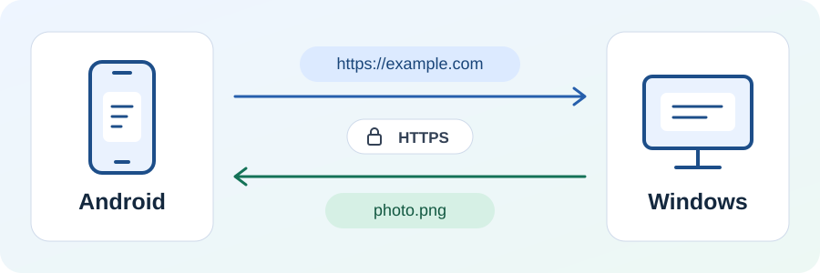

# LanInbox

[简体中文](README.zh-CN.md)

**LanInbox is a local-network inbox for Android and Windows.** Send a link from your phone to
your PC to keep reading, or send a screenshot back to your phone. Text, links, code snippets,
images, and files go directly between the two devices on the same network.

## What you can do

- **Send a link from the Android share menu.** Share a link or text to LanInbox to open it as a
  draft, then send it to the Windows inbox.
- **Pair by QR code and send over HTTPS.** Scan the invitation on your PC to set up encrypted
  transfers in both directions.
- **Find the same PC after its IP address changes.** The pairing survives app restarts, and
  Android can rediscover the paired PC on the local network.
- **Use what you receive.** Copy text and code, preview supported images, or save files from the
  inbox.

## Install and try it

In this repository’s **Actions** tab, open a successful **Verify LanInbox** run. Under
**Artifacts**, download and unzip `laninbox-verification-builds`. Install the Debug APK on
Android and the MSI on Windows, or follow the build instructions below.

### Send your first link

1. Connect the phone and PC to the same local network and open LanInbox on both.
2. On Windows, choose **Create pairing invitation**. On Android, tap **Scan pairing QR code**
   and scan the code on your PC.
3. On Android, paste `https://example.com` into the send form and tap **Send**. Open the Windows
   **Inbox** to copy the link.

After pairing, use **Choose file or image** at the top of Android’s **Send** tab or the Windows
**Inbox**. Selecting a file starts the transfer. When sending to the phone, keep LanInbox in the
foreground on Android until the file appears in its inbox.

### Connection troubleshooting

- **Pair manually.** Enter the LAN address, certificate fingerprint, and pairing invitation
  shown on Windows into the Android app.
- **Check local network access.** Grant permission on Android when prompted and allow LanInbox
  through Windows Firewall on private networks.
- **Reconnect after an IP change.** If discovery fails, enter the PC’s current LAN address and
  tap **Reconnect to paired computer**.

## Project structure

LanInbox is built with Kotlin Multiplatform and Compose Multiplatform.

- [`shared/`](shared) contains the shared UI, transfer protocol, and HTTPS client.
- [`androidApp/`](androidApp) contains the Android app and platform integrations.
- [`desktopApp/`](desktopApp) contains the Windows app, local receiver, and MSI packaging.

## Build from source

Open the repository in Android Studio and sync with JDK 21 and Android SDK Platform 37.
Set `JAVA_HOME` to JDK 21 and run these commands from the repository root in Windows PowerShell.

- Build the Android APK with `.\gradlew.bat :androidApp:assembleDebug`. Find it in
  `androidApp/build/outputs/apk/debug/`.
- Launch the Windows app with `.\gradlew.bat :desktopApp:run`.
- To build a Windows MSI, install WiX 3.14.1, set `WIX_PATH` to the directory containing
  `candle.exe` and `light.exe`, then run `.\gradlew.bat :desktopApp:packageMsi`.
