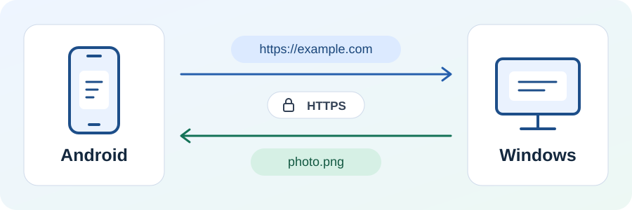

# LanInbox · 局域网快传

[English](README.md)

**LanInbox 是 Android 和 Windows 之间的局域网收件箱。** 把手机上的网页链接发到电脑接着看，或把电脑上的
截图发回手机。文字、链接、代码片段、图片和文件都在同一局域网内直接传输。

## 功能亮点

- **从 Android 分享菜单发送链接。** 将链接或文字分享到局域网快传，内容会填入发送草稿，确认后就能发到
  Windows 收件箱。
- **扫二维码配对，双向加密传输。** 扫描电脑上生成的配对二维码后，两端就可以通过 HTTPS 收发。
- **电脑换 IP 后仍能找回。** 重启应用后会保留配对记录，手机可以在局域网内重新发现已配对的电脑。
- **收到就能用。** 在收件箱复制文字和代码、预览支持的图片，或把文件另存到所需的位置。

## 安装与试用

在仓库的 **Actions** 页面打开一次成功的 **Verify LanInbox** 构建，从 **Artifacts** 下载并解压
`laninbox-verification-builds`。在 Android 安装调试版 APK，在 Windows 安装 MSI。也可以按页末的步骤从源码构建。

### 发送第一条链接

1. 让手机和电脑连到同一局域网，在两端打开 LanInbox。
2. 在 Windows 点击 **连接手机** 显示二维码，在 Android 点击 **扫码连接** 扫描电脑上的二维码。
3. 在 Android 首页的发送区粘贴 `https://example.com`，点击 **发送**。在 Windows 的 **收件箱** 复制链接。

配对后，在任一设备的发送区点击 **选文件**，确认选中的文件后点击 **发送**。发送到手机时，
请让 Android 应用保持在前台，直到文件出现在收件箱里。

### 连接排查

- **手动配对。** 打开 Windows 的 **连接详情**，在 Android 的 **手动连接** 中填写局域网地址、证书指纹和配对邀请。
- **检查局域网权限。** Android 提示时授予局域网访问权限，并在 Windows 防火墙中允许 LanInbox 在专用网络上通信。
- **电脑换 IP 后重连。** 如果自动发现失败，打开 **手动连接**，输入电脑当前的局域网地址，再点击 **重新连接已配对电脑**。

## 项目结构

项目使用 Kotlin Multiplatform 和 Compose Multiplatform。

- [`shared/`](shared) 包含共享界面、传输协议和 HTTPS 客户端。
- [`androidApp/`](androidApp) 包含 Android 应用和平台适配。
- [`desktopApp/`](desktopApp) 包含 Windows 应用、局域网接收服务和 MSI 打包配置。

## 从源码构建

在 Android Studio 中打开仓库，使用 JDK 21 和 Android SDK Platform 37 完成 Gradle 同步。
将 `JAVA_HOME` 指向 JDK 21，再在 Windows PowerShell 中从仓库根目录运行以下命令。

- 构建 Android APK 使用 `.\gradlew.bat :androidApp:assembleDebug`，产物在
  `androidApp/build/outputs/apk/debug/`。
- 启动 Windows 应用使用 `.\gradlew.bat :desktopApp:run`。
- 打包 Windows MSI 需要 WiX 3.14.1。将 `WIX_PATH` 设为 `candle.exe` 和 `light.exe` 所在目录，再运行
  `.\gradlew.bat :desktopApp:packageMsi`。
